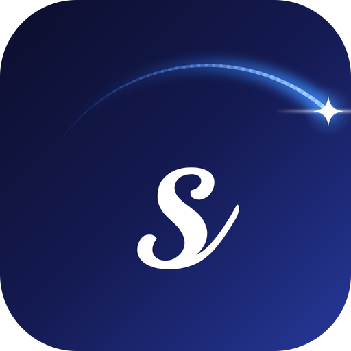
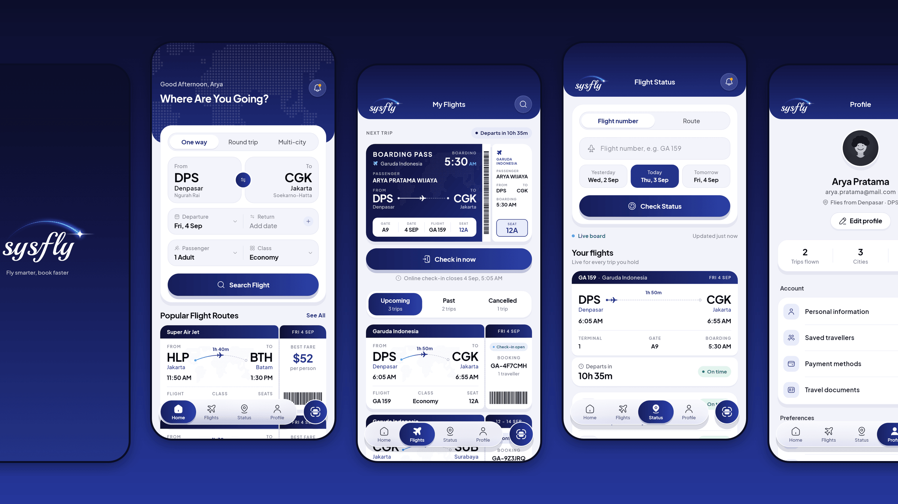
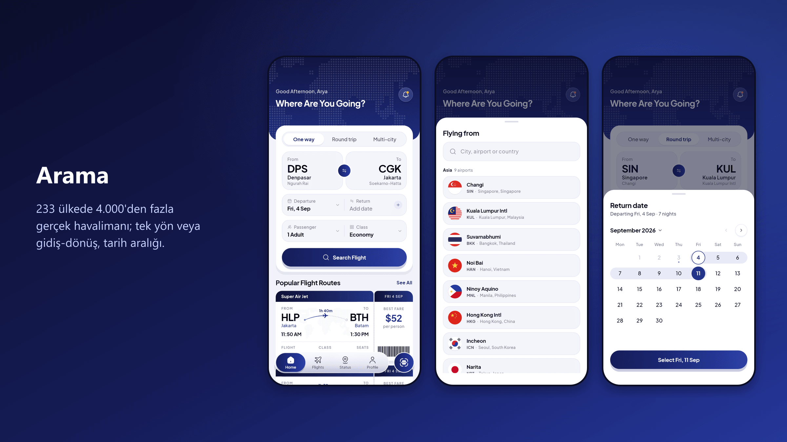
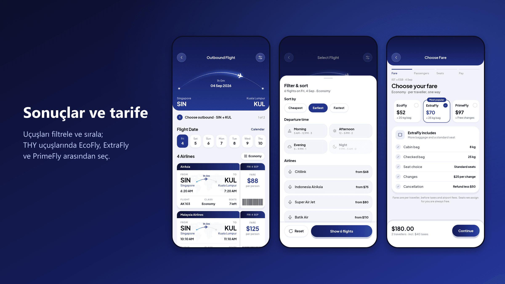
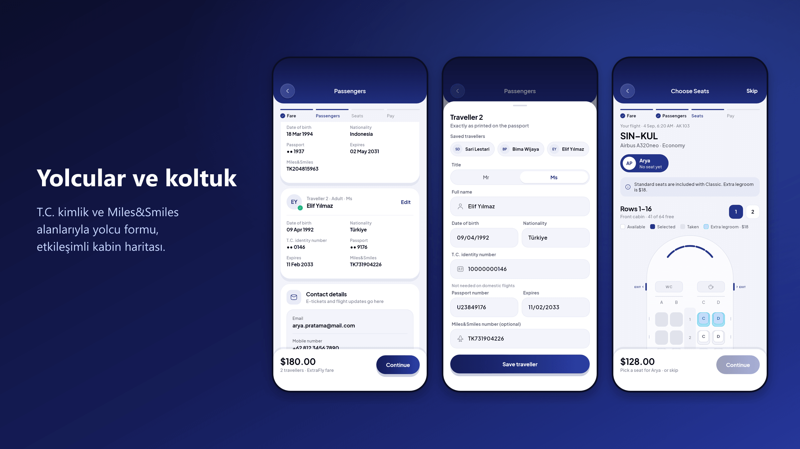
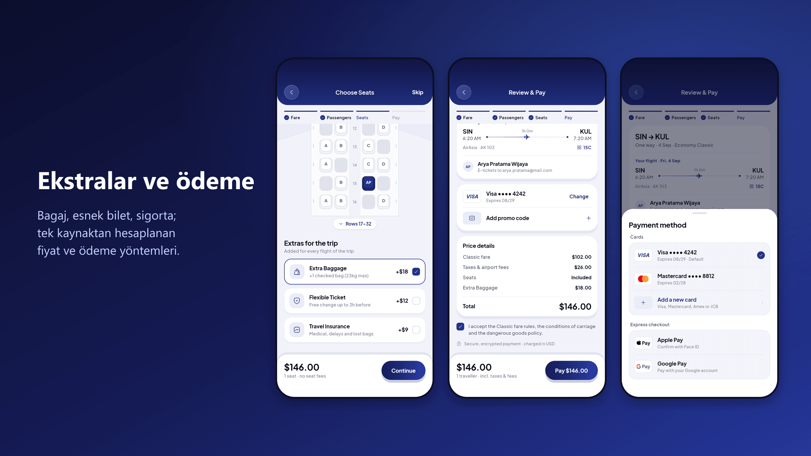
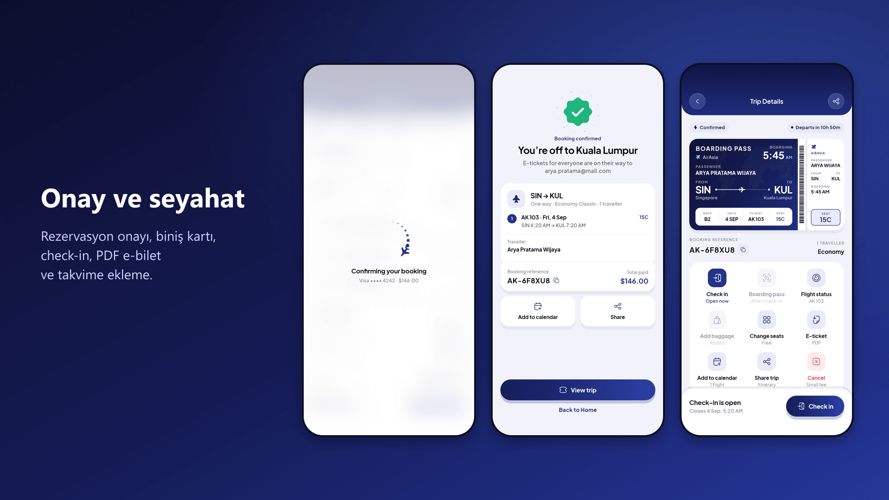
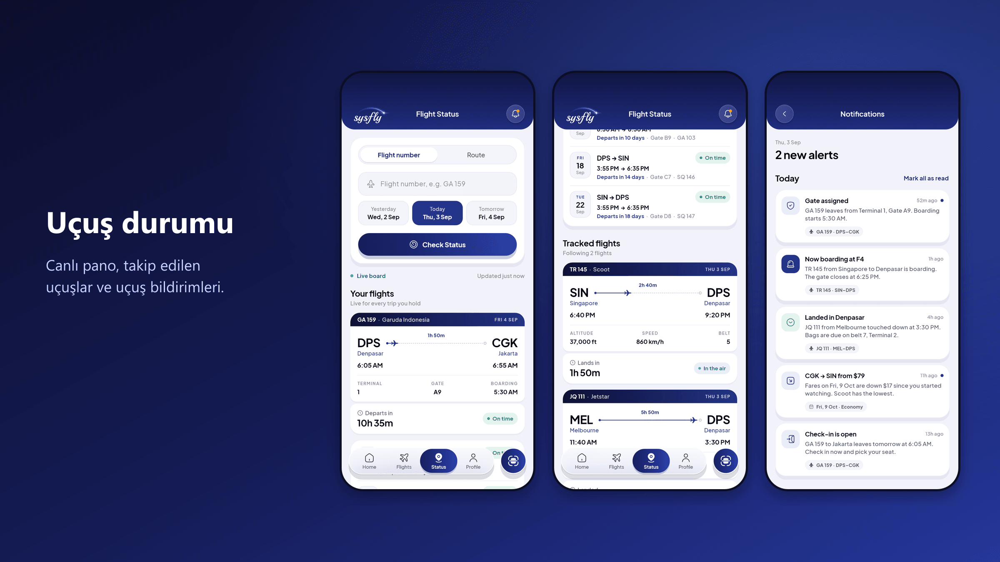
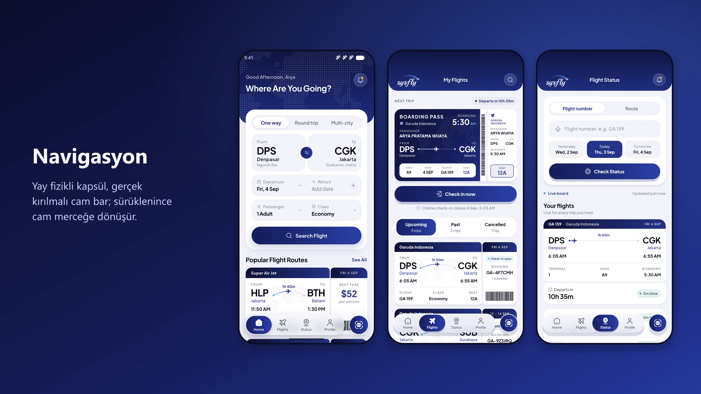
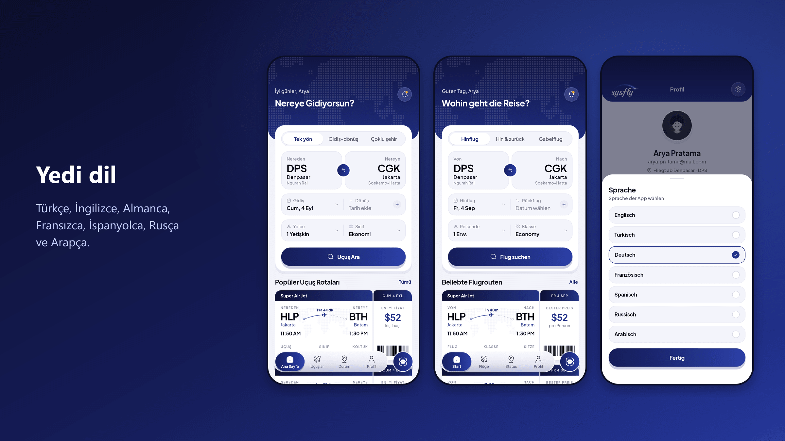

<div align="center">



# sysfly

**Akıllı uç, hızlı rezerve et.**

<br>



<br>
<br>

Uçuş aramadan biniş kartına kadar bütün yolculuğu tek akışta toplayan,<br>
Flutter ile yazılmış, iPhone öncelikli bir uçak bileti rezervasyon uygulaması.

<br>

**[Ekranlar](#ekranlar)** &nbsp;·&nbsp; **[Özellikler](#özellikler)** &nbsp;·&nbsp; **[Mimari](#mimari)** &nbsp;·&nbsp; **[Çalıştırma](#çalıştırma)** &nbsp;·&nbsp; **[Testler](#testler)** &nbsp;·&nbsp; **[Güvenlik](#güvenlik)**

</div>

<br>

<table>
  <tr>
    <td width="50%" valign="top">
      <h4>✈️&nbsp; Uçtan uca rezervasyon</h4>
      Arama, tarife, yolcu, koltuk, ekstralar, ödeme, onay ve biniş kartı; her adımda seçimler korunur, fiyat tek kaynaktan hesaplanır.
    </td>
    <td width="50%" valign="top">
      <h4>🌍&nbsp; Gerçek havalimanları</h4>
      233 ülkede tarifeli seferi olan 4.007 havalimanı; THY uçuşlarında EcoFly, ExtraFly ve PrimeFly tarife aileleri.
    </td>
  </tr>
  <tr>
    <td width="50%" valign="top">
      <h4>🫧&nbsp; Hareket ve cam</h4>
      Yay fizikli navigasyon kapsülü, gerçek kırılmalı cam bar, çizilen uçuş izi, dönen uçak yükleyici.
    </td>
    <td width="50%" valign="top">
      <h4>🗣️&nbsp; Yedi dil</h4>
      Türkçe, İngilizce, Almanca, Fransızca, İspanyolca, Rusça ve Arapça; dil değişince tüm ekranlar anında güncellenir.
    </td>
  </tr>
</table>

<br>

## Ekranlar

<p align="center"></p>
<p align="center"></p>
<p align="center"></p>
<p align="center"></p>
<p align="center"></p>
<p align="center"></p>
<p align="center"></p>
<p align="center"></p>

<p align="center"><sub>Ekranlar uygulamanın kendi bileşenleriyle 440 × 956 pt (iPhone 17 Pro Max) boyutunda çizilmiş gerçek görüntülerdir; navigasyon görüntüsü Android emülatöründen alınmıştır.</sub></p>

<br>

## Özellikler

| Alan | Özellikler |
| :-- | :-- |
| **Arama** | Tek yön ve gidiş-dönüş · 4.007 havalimanı ülke ülke listelenir; kod, şehir, havalimanı ve ülke adıyla arama · gidiş ve dönüş için tarih aralığı gösteren özel takvim · yolcu sayısı ve kabin sınıfı · havalimanı değiştirme animasyonu |
| **Sonuçlar** | Haftalık tarih şeridi · en ucuz, en erken, en hızlı sıralama · kalkış saati ve havayolu filtresi (filtreler sonuçları gerçekten daraltır) · havayolu başına en düşük fiyat |
| **Tarife** | Lite, Classic, Flex · THY uçuşlarında EcoFly, ExtraFly, PrimeFly; bagaj hakkı, koltuk seçimi, değişiklik ve iade kuralları |
| **Yolcular** | Unvan, ad soyad, doğum tarihi, uyruk · Türkiye vatandaşları için T.C. kimlik numarası (resmî kontrol hanesi algoritmasıyla) · iç hatlarda pasaport isteğe bağlı · Miles&Smiles numarası · kayıtlı yolcular · iletişim bilgileri |
| **Koltuk** | İki bölümlü etkileşimli kabin haritası · müsait, dolu, seçili, ekstra bacak mesafesi · çıkış sıraları · her yolcuya ayrı koltuk · ücretli koltukta fiyat anında güncellenir |
| **Ödeme** | Ekstra bagaj, esnek bilet, seyahat sigortası · promosyon kodu · kayıtlı kartlar, yeni kart (Luhn ve son kullanma kontrolü), Apple Pay, Google Pay · şartları kabul etmeden ödeme yapılamaz |
| **Seyahat** | Rezervasyon kodu · biniş kartı · check-in · bagaj ekleme · koltuk değiştirme · iptal ve iade hesabı · PDF e-bilet · `.ics` takvim dosyası · paylaşma |
| **Uçuş durumu** | Uçuş numarası veya rotayla sorgulama · dün, bugün, yarın · zaman çizelgesi · irtifa, hız, bagaj bandı · uçuş takibi |
| **Bildirimler** | Kapı, biniş, iniş, fiyat düşüşü, check-in bildirimleri · okundu bilgisi uygulama kapansa da korunur · bildirime dokununca ilgili ekran açılır |
| **Profil** | Kişisel bilgiler, kayıtlı yolcular, ödeme yöntemleri, seyahat belgeleri · koltuk tercihi · dokunsal geri bildirim · dil |
| **Erişilebilirlik** | Ekran okuyucu etiketleri · Hareketi Azalt desteği · 1,3 kata kadar büyük yazı · yedi dilde taşmasız düzen |

<br>

## Hareket

Animasyonlar referans kayıttan kare kare ölçülerek yazıldı; süreler ve eğriler [`docs/ANIMATION_SPEC.md`](docs/ANIMATION_SPEC.md) içinde.

| Öğe | Nasıl |
| :-- | :-- |
| **Navigasyon kapsülü** | Tek parça kapsül sönümlü bir yayla (kütle 1, sertlik 400, sönüm 28) kayar, hızıyla genişler, hedefi ~%5 aşar ve bar kenarına sıkışır. İkonlar kapsülün kapladığı yerde renk değiştirir. Art arda dokunuşlarda hız korunur. |
| **Cam mercek** | Kapsül sürüklenince 150 ms'de şeffaf merceğe dönüşür ve altındaki ikonları büker; bırakınca en yakın sekmeye oturur. Impeller olan cihazlarda gerçek kırılma, diğerlerinde bulanık cam. |
| **Splash** | Logo belirir, uçuş izi `PathMetric` ile çizilir, ucundaki uçak yıldıza dönüşür, slogan gelir; 3,1 saniye. |
| **Yükleyici** | Arka plan bulanıklaşır, uçak 2,4 saniyede bir tur atar; gerçek işlem sürdüğü kadar ekranda kalır. |

<br>

## Mimari

```text
lib/
├── app/            # MaterialApp, go_router rotaları, tema
├── core/
│   ├── design_system/  # renk, gradyan, tipografi, ölçü, hareket ve ikon token'ları
│   ├── l10n/           # çeviri motoru ve 530 girişlik çeviri tablosu
│   ├── services/       # paylaşım, dokunsal geri bildirim
│   ├── storage/        # tercihler (shared_preferences)
│   └── utils/          # biçimlendirme, doğrulama, PDF ve takvim üretimi
├── data/
│   ├── datasources/    # havalimanı kataloğu (assets/data/airports.tsv)
│   ├── generated/      # yedi dilde ülke adları
│   ├── mock/           # örnek tarife, koltuk, seyahat ve bildirim verisi
│   └── repositories/   # arayüzler ve demo uygulamaları
├── features/       # ekranlar: arama, sonuçlar, rezervasyon, koltuk, ödeme, seyahatler, durum, bildirimler, profil
└── shared/         # modeller ve 25 ortak bileşen
```

| Katman | Sorumluluk |
| :-- | :-- |
| **features/** | Her ekran kendi klasöründe; durum Riverpod `Notifier`'larında. Rezervasyon tek bir `BookingDraft` üzerinden ilerler, geri dönüldüğünde seçimler kaybolmaz. |
| **data/repositories** | `AuthRepository`, `FlightRepository`, `BookingRepository`, `FlightStatusRepository`, `NotificationRepository`. Ekranlar yalnızca arayüzleri tanır; gerçek servisler `providers.dart` içinde tek satırla bağlanır. |
| **shared/widgets** | `SysflyFloatingNavigationBar`, `SysflyFlightTicket`, `SysflyBoardingPass`, `SysflySeatMap`, `SysflyDatePicker`, `SysflyLoadingOverlay` ve diğerleri. |
| **core/design_system** | Hiçbir ekran kendi rengini veya ölçüsünü üretmez; değerler referanstan ölçülerek tek yerde tutulur ([`docs/DESIGN_SYSTEM.md`](docs/DESIGN_SYSTEM.md)). |
| **core/l10n** | Ekranlar İngilizce yazılır, metin çizilirken çevrilir. Birleşik metinler ("Departs in 10h 35m") kalıplarla, tarihler ve ay adları ayrıca çevrilir; Rusça çoğullar desteklenir. |

<br>

| Alan | Teknoloji |
| :-- | :-- |
| Dil | Dart 3.11 |
| Arayüz | Flutter 3.41, `CustomPainter`, `BackdropFilter`, `liquid_glass_renderer` |
| Durum | flutter_riverpod 2 |
| Gezinme | go_router 17 |
| İkonlar | Hugeicons (rounded stroke), Phosphor |
| Yazı | Plus Jakarta Sans, Playball (OFL) |
| Kalıcılık | shared_preferences |
| Paylaşım | share_plus |
| Test | flutter_test, golden testler, integration_test |

<br>

## Çalıştırma

```bash
flutter pub get
flutter run
```

Giriş için herhangi bir e-posta ve en az 6 karakterlik şifre yeterli. Kayıtlı demo hesabı `arya.pratama@mail.com` / `sysfly123`.

**Android sürüm derlemesi** imza bilgilerini depoya girmeyen `android/key.properties` dosyasından okur:

```properties
storeFile=/mutlak/yol/upload-keystore.jks
storePassword=...
keyAlias=upload
keyPassword=...
```

Dosya yoksa sürüm derlemesi debug anahtarıyla imzalanır; bu derleme mağazaya yüklenemez.

**Havalimanı verisini yenilemek** için `node tool/build_airport_data.js`, **README görsellerini ve uygulama ikonunu üretmek** için `flutter test test/visual --update-goldens` ardından `node tool/build_readme_screens.js` (sharp gerekir).

<br>

## Testler

```bash
flutter analyze
flutter test
flutter test integration_test/app_test.dart -d <cihaz>
```

| Paket | Kapsam |
| :-- | :-- |
| `test/unit` | Fiyat hesabı, filtre ve sıralama, örnek tarife, koltuk haritası, doğrulayıcılar (T.C. kimlik, Luhn, Miles&Smiles), PDF yapısı, takvim dosyası |
| `test/widgets` | Navigasyon barı: kapsülün yolu, yay aşımı, esneme, hızlı dokunuşlar, sürükleme, Hareketi Azalt, erişilebilirlik |
| `test/flows` | Aramadan My Flights'a uçtan uca rezervasyon |
| `test/l10n` | Çeviri tablosu bütünlüğü, çeviri motoru, havalimanı kataloğu, 14 ekranın altı dilde taşmadan çizilmesi, anında dil değişimi |
| `test/visual` | 29 ekranın ve uygulama ikonunun görüntü karşılaştırması |
| `integration_test` | Cihazda giriş, sekme geçişleri ve mercek sürükleme |

Son çalıştırmada 80 testin tamamı geçti.

<br>

## Güvenlik

- Kart numarası ve güvenlik kodu hiçbir yere yazılmaz; yalnızca marka, son dört hane ve son kullanma tarihi tutulur.
- Kart, pasaport ve kimlik numarası alanlarında klavye önerisi ve öğrenmesi kapalı.
- Şifre saklanmaz; "Beni hatırla" yalnızca e-postayı tutar.
- Android'de uygulama verisi bulut yedeğine ve cihazdan cihaza aktarıma kapalı.
- Uygulama ağa çıkmaz; Android sürüm derlemesinde internet izni yok.
- Sürüm derlemesi küçültülür (R8) ve imza bilgileri `.gitignore` ile depo dışında tutulur.

<br>

## Veri ve lisanslar

- **Havalimanları:** [OurAirports](https://ourairports.com/data/) (kamu malı). **Saat dilimleri:** [OpenFlights](https://openflights.org/data) ([Open Database License](https://opendatacommons.org/licenses/odbl/1-0/)). **Ülke adları:** [Unicode CLDR](https://cldr.unicode.org/) (Unicode License).
- **Yazı tipleri:** Plus Jakarta Sans ve Playball, SIL Open Font License. **İkonlar:** Hugeicons ve Phosphor.
- Uçuşlar, saatler, fiyatlar, koltuklar ve uçuş durumları **örnek veridir**. THY tarife aileleri ve bagaj hakları kamuya açık bilgilerden sadeleştirilmiştir; gerçek kurallar rotaya göre değişir.
- Ödeme bir simülasyondur; para çekilmez, gerçek bilet düzenlenmez, e-posta gönderilmez.
- Turkish Airlines, Miles&Smiles ve diğer havayolu adları sahiplerinin markalarıdır; bu proje hiçbiriyle bağlantılı değildir.

<br>

## Durum

Tamamlananlar, doğrulamalar ve açık kalanlar [`docs/PROGRESS.md`](docs/PROGRESS.md) içinde. iOS derlemesi henüz bir Mac üzerinde doğrulanmadı.
